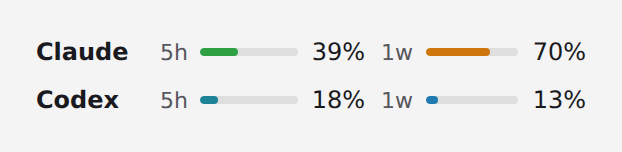
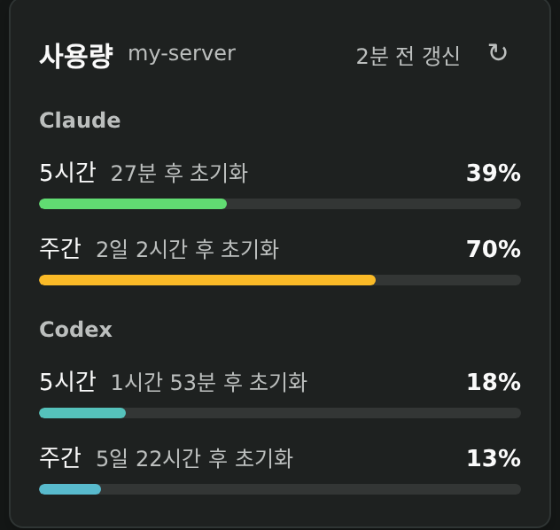
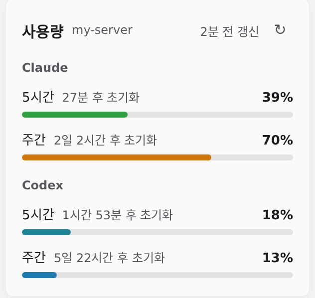

# paseo-usagegraph

[Paseo](https://paseo.sh) 사이드바 하단에 **Claude**와 **Codex**의 사용량을 작은 막대로 보여주는 플러그인입니다.

<p>
  
  
</p>

## 기능

- **한눈에 보는 사용량** — 서비스마다 한 줄에 `5h`(5시간)와 `1w`(주간) 사용률을 함께 표시합니다.
- **사용량에 따른 색** — 막대 색이 사용률에 따라 🔵 파랑 → 🟢 초록 → 🟡 노랑 → 🔴 빨강으로 자연스럽게 바뀝니다. 다크·라이트 테마마다 잘 보이는 색조를 씁니다.
- **상세 팝오버** — 위젯을 누르면 초기화까지 남은 시간과 새로고침 버튼이 있는 상세 화면이 열립니다. 새로고침 중에는 아이콘이 돌고, 끝나면 "✓ 확인 완료"가 잠깐 표시됩니다.
- **자동 갱신** — 1분마다 다시 조회합니다. 수치는 Paseo 서버의 사용량 캐시(기본 5분)를 따르므로 조금 늦게 반영될 수 있고, 팝오버에 마지막 갱신 시각이 표시됩니다.
- **상태 안내** — 조회 실패, 공급자 오류, 사용 불가(로그인·요금제), 표시할 구간 없음을 구분해서 보여줍니다. 갱신에 실패하면 이전 값임을 표시하고 다시 시도할 수 있습니다.

<p>
  
  
</p>

## 설치

```bash
paseo plugin install git:kimmdr2/paseo-usagegraph
```

Paseo `0.11.2` 이상 `0.12.0` 미만에서 동작합니다.

## 개발

```bash
git clone https://github.com/kimmdr2/paseo-usagegraph.git
cd paseo-usagegraph
npm install
npm run typecheck

# 로컬 폴더를 플러그인으로 등록하고, 수정 후 다시 불러오기
paseo plugin install ./
paseo plugin reload paseo-usage-graphs
```

UI 코드는 [`client/usage-graphs.tsx`](client/usage-graphs.tsx) 한 파일에 있습니다.

## 참고

Paseo에 내장된 사용량 조회 기능만 사용합니다. 인증 파일을 직접 읽거나 계정 설정을 바꾸지 않습니다.
